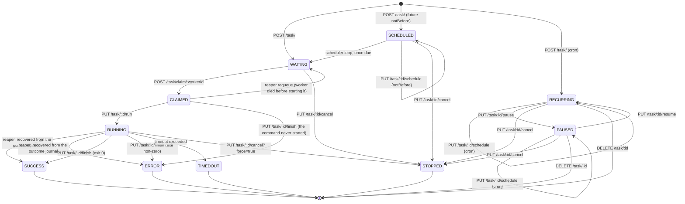
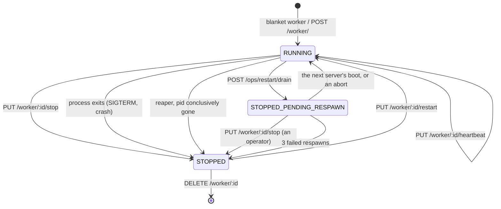
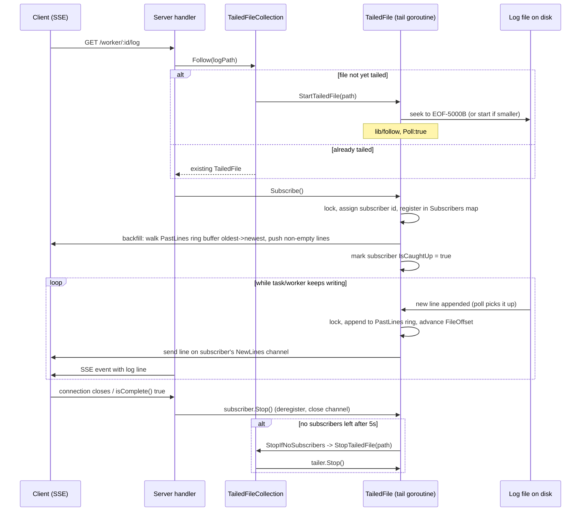

# Task Flow

The state machines for tasks and workers, the endpoints that drive each
transition, and the background loops that reconcile what a crash leaves
behind. Request and response shapes are in [api.md](api.md).

## Task states

| State | Description |
| ------ | ------- |
| SCHEDULED | Submitted with a future `notBefore`; not yet in the queue. See [Scheduling](#scheduling-notbefore-and-cron). |
| RECURRING | A recurring template (submitted with `cron`); never runs itself, only spawns children. |
| PAUSED | A RECURRING template that was paused; carries `pausedTs` and never fires until resumed. |
| WAITING | Posted and in the queue, not yet claimed. |
| CLAIMED | A worker has claimed it; it is out of the queue and tracked only in the database. |
| RUNNING | The worker has run the preconditions (task type state, template files) and the main command is running. The worker may send progress updates. |
| SUCCESS | The command exited 0. |
| ERROR | The command exited non-zero, or the worker hit an error running it. |
| STOPPED | Cancelled by a user; a running command was killed. |
| TIMEDOUT | Exceeded its timeout and was killed. |

Valid states are `tasks.ValidTaskStates` (`tasks/tasks.go`); terminal
states are `ValidTerminalTaskStates`.

## Task state machine

A task takes one of two terminal paths: claimed and run to completion
(`SUCCESS` / `ERROR` / `TIMEDOUT`), or cancelled (`STOPPED`), either
before a worker claims it or after the worker sees the cancellation and
kills the command. A RECURRING template has a third: cancelled (record
kept) or deleted (record removed) without ever running, after any number
of trips through PAUSED.



`exitCode` is set on the `RUNNING → SUCCESS/ERROR` transition, from the
status the worker reads after `cmd.Wait()`. Transitions where the process
was killed (`STOPPED`, `TIMEDOUT`) leave it `null`.

### How `POST /task/?wait` observes the state machine

`?wait` changes nothing above: the task is
saved, queued, claimed, run and finished by the same transitions; only
the submitting request stays open instead of returning at `WAITING`.

```
POST /task/?wait ──> WAITING ──> CLAIMED ──> RUNNING ──> SUCCESS/ERROR/TIMEDOUT
       │                                                        │
       └──────────────── the request is still open ─────────────┘
                              200 + completion payload
```

The handler subscribes to the server's task-event hub *before* enqueueing
(so a task that finishes unusually fast cannot slip through), then wakes
on the hub, a ~1s fallback ticker, request cancellation, or the deadline,
re-reading the record each time and stopping at a terminal state. The hub
carries no payload; the record is the source of truth. So the wait
expiring changes nothing (504, keep polling), and a disconnected client
changes nothing either (the handler releases its subscription).

`&stream`, or `GET /task/:id/log` with `Accept: application/x-ndjson`,
attaches the same loop and reports each transition as a `state` event,
`log` events once the task is `CLAIMED` and its files exist, and a
terminal `result` event. See
[api.md](api.md#stream-a-task-as-it-runs-post-taskwaitstream).

### Scheduling: `notBefore` and `cron`

By default a submitted task is immediately claimable (`WAITING`). Two
`POST /task/` fields change that (shapes in
[api.md](api.md#submit-a-task-post-task)):

- **`notBefore`** delays a one-shot task. A future time saves it as
  `SCHEDULED` with `scheduledTs` set and **not** in the queue. Otherwise
  it is a normal record: visible via `GET /task/:id`, cancelable without
  `force`.
- **`cron`** makes it a `RECURRING` **template**, never queued or run
  itself. It carries `cronExpr` and `nextFireTs`; when that time arrives
  the scheduler spawns a **child task** (fresh id, own log and result
  dir, the template's type/env/tags, `parentId` set to the template) that
  goes through the ordinary `WAITING` lifecycle, then advances
  `nextFireTs`.

Both are ordinary BoltDB rows, so they survive a restart: the scheduler
loop finds whatever is due and acts on it.

### Pause, resume, cancel, or reschedule a series

- **Pause** (`PUT /task/:id/pause`, `RECURRING` only) moves the template
  to `PAUSED` and records `pausedTs`. The fire step only looks at
  `RECURRING` templates, so nothing more is needed.
- **Resume** (`PUT /task/:id/resume`, `PAUSED` only) returns it to
  `RECURRING`, clears `pausedTs`, and recomputes `nextFireTs` from now,
  so a long pause does not fire a backlog of missed occurrences.
- **Cancel** (`PUT /task/:id/cancel`, on `RECURRING`/`PAUSED` as well as
  `WAITING`/`SCHEDULED`) moves it to `STOPPED` and keeps the record, so it
  still appears in the series' history. It never fires again.
- **Delete** (`DELETE /task/:id`) removes the record outright. Either way
  of stopping a template leaves children it already spawned running.
- **Change schedule** (`PUT /task/:id/schedule`): `{"cron": "..."}` on a
  `RECURRING` or `PAUSED` template (`nextFireTs` is recomputed from now
  unless paused, in which case on resume), or `{"notBefore": "..."}` on a
  `SCHEDULED` task (any [time form](api.md#time-formats); must still be
  in the future).
  Any other body/state combination is 400; an invalid value is 400 with
  the parser's message; a missing id is 404.

### Friendly schedule text: `scheduleDescription`

Every task response carries a computed `scheduleDescription`, derived
from `state`/`cronExpr`/`scheduledTs` and never stored
(`tasks.ScheduleDescriptionFor`, `tasks/schedule.go`):

- `SCHEDULED`: `"Once, at <scheduledTs as RFC3339, local time>"`.
- `RECURRING` / `PAUSED` / a cancelled template: an English rendering of
  the cron expression via
  [`github.com/lnquy/cron`](https://github.com/lnquy/cron), e.g.
  `"Every 5 minutes"`, suffixed `" (paused)"` / `" (stopped)"` so the text
  stands alone in `blanket ps` or an MCP result.
- Anything else, including a `STOPPED` task that was never scheduled:
  `""`.

`GET /schedule/describe?cron=<expr>` returns the same description plus
the next three fire times
([api.md](api.md#describe-a-schedule-get-scheduledescribe)).

### Past runs of a series: `?parentId=`

`GET /task/?parentId=<template-id>` lists a series' child runs regardless
of the template's current state, combinable with the other list filters
(`?parentId=<id>&states=ERROR`). The series detail page's "Past runs"
table is built on it; the inverse link is the series card on a child's
detail page ([usage.md](usage.md#web-ui)).

### Scheduler loop

One background goroutine, started from `ServerConfig.Serve()` via
`startBackgroundLoops` (`server/scheduler.go`), ticks every
`scheduler.interval` (default `2s`) and:

1. **Promotes due `SCHEDULED` tasks** to `WAITING` and adds them to the
   queue. Safe to repeat: the DB write is an overwrite and the queue add
   upserts by id, so an overlapping tick or a mid-promotion restart cannot
   double-queue a task.
2. **Fires due `RECURRING` templates** (never `PAUSED` or `STOPPED`):
   spawns the child, then advances `nextFireTs`. A crash between the two
   fires an equivalent child again on restart — at-least-once, not
   exactly-once. Cron-driven task types should tolerate an occasional
   duplicate, as a `cron(8)` script should.

`startBackgroundLoops` takes one more line per periodic loop;
[the reaper](#the-reaper) is the second one.

### Scan limit: `scheduler.maxScheduled`

Both scheduler queries, and the count check below, are bounded by
`scheduler.maxScheduled` (default `10000`,
`ServerConfig.SchedulerMaxScheduled`). There is no pagination beyond it:
each tick scans at most that many rows per query, which fits batch
scheduling rather than a high-volume cron system.

The same number is a hard cap: `POST /task/` and the MCP
`blanket_submit_task` tool return **429** when a future-`notBefore` or
`cron` submission would bring the live `SCHEDULED` + `RECURRING` +
`PAUSED` count to the limit. The count uses the same bounded `Limit`
(`ServerConfig.scheduledLiveCount`), so it never scans more rows than
that. An immediately-`WAITING` submission never counts.

### Cancel a running task: `?force=true`

`PUT /task/:id/cancel` on a `WAITING` task is a pure database transition.
On a `RUNNING` task the process is a child of some *worker*, which the
server cannot signal directly, so cancelling requires an explicit
`?force=true`; without it the endpoint is 400 and the task is untouched.

With `force=true` the server flips the record to `STOPPED` and the worker
does the rest: `ProcessOne` (`worker/worker.go`) runs a monitor goroutine
that polls the task's state every `CheckInterval` and, on seeing
`STOPPED`, kills the subprocess (`cmd.Process.Kill()`). No server-to-worker
RPC is involved, so the process may run for up to one `CheckInterval`
after the cancel call.

Until the worker reports the process gone, the record carries
`stopPendingTs`, and `DELETE /task/:id` refuses the task with a 400
(turtlemonvh/blanket#252). The worker can only see the `STOPPED` while
the record exists: if the record is deleted, the worker reads a 404,
treats it like an unreachable server (it fails open so an outage never
kills work), and leaves the process running. The worker's report after
the kill doesn't change the state (the user's `STOPPED` wins, see
below), but it clears `stopPendingTs`. If no report arrives, the task
becomes deletable 60s after the cancel.

### Which tasks `DELETE /task/:id` accepts

A task is deletable when no process can be behind it: `WAITING`,
`SCHEDULED`, `RECURRING`, `PAUSED`, and the terminal states, except a
force-cancelled task whose kill is still pending (above). `CLAIMED` and
`RUNNING` are a 400; cancel first. The state check runs in the same bolt
transaction as the delete. A worker can still claim a `WAITING` task's
queue entry after the task is deleted, because the queue is a separate
bucket. The claim then finds no record, acks the entry away and answers
404, so nothing runs.

### Idempotent `run`/`finish` and the `runId` fencing token

The worker retries `PUT /task/:id/run` and `PUT /task/:id/finish`, so
both are idempotent on `runId`, a token generated just before the child
starts: a repeat with the same token is a 200 no-op, a different token
is a 409 the worker never retries, and an empty token is accepted
(workers from before v0.3.0 send none). The first terminal state a task
reaches sticks, so a user's
`STOPPED` beats the `ERROR` the worker reports when the killed child
exits, and the worker is told 200 so it stops retrying. The response
table is in [api.md](api.md#runid-the-fencing-token-for-one-run).

### Task output files

A task's result dir holds three output files:

```
<resultDir>/blanket.stdout.log        # raw bytes the task wrote to stdout
<resultDir>/blanket.stderr.log        # raw bytes the task wrote to stderr
<resultDir>/blanket.combined.ndjson   # how the two interleaved
```

The first two are the task's own bytes, unmodified, and every API surface
that reports output reads them. The third answers the one question they
cannot: **what order did the task produce this in?** Two independent
files carry no shared ordering, so a reader with only those two can
group them (all of stdout, then all of stderr) but not interleave them.

The worker **tails** the two files as they are written and appends one
JSON object per completed line, in the order it saw them land:

```
{"ts":1756900001123,"stream":"stdout","seq":1,"line":"starting"}
{"ts":1756900001250,"stream":"stderr","seq":1,"line":"warning: no config"}
{"ts":1756900001410,"stream":"stdout","seq":2,"line":"done"}
```

`ts` is unix **milliseconds** (the event envelope's is seconds), `seq`
counts within one stream from 1, and the field names are
`server.LogEvent`'s so the file and the structured `log` event cannot
drift. Partial lines are buffered until their newline; whatever is
unterminated when the task ends is flushed as a final record.

"The order the worker saw them land" is the limit of what this can be:
the same basis as the live log view, not a kernel-level total order. A
task that writes to both streams at once and exits leaves the two tailers
to be scheduled in whatever order the runtime picks. What the file
guarantees is that replayed history and live output are ordered the same
way.

`workers.combinedLog` (default `true`) turns the recording off. Nothing
else changes: the child's streams are the two log files either way, there
is just no third file and no tailer per task, and readers fall back to
the grouped view, as they do for tasks run before v0.3.0.

#### Why the worker tails the files instead of piping the streams

Putting the worker between the child and the files
(`cmd.Stdout = io.MultiWriter(logFile, recorder)`) would change what the
child's stdout *is*: an
`*os.File` handed straight to the child becomes a pipe the worker owns. A
task that starts a process and exits (a daemon launcher, `nohup … &`,
anything under `setsid`) leaves that process holding the write end, so
`cmd.Wait()` blocks until it closes — maybe never. `cmd.WaitDelay` trades
the hang for worse: a couple of seconds after the task exits, os/exec
closes the pipe under the orphan, its output is gone, and the next write
can kill it with `SIGPIPE`. A file has no owner: the orphan keeps
appending to `blanket.stdout.log`, as it always has. **Missing logs are
worse than missing ordering.** So the child gets the files and the
worker opens a tailer per stream (`lib/follow`; fsnotify on unix, polling
on Windows) right after the process starts.

#### The grace window after exit

When `cmd.Wait()` returns, the worker keeps tailing until both files have
been quiet for **400ms**, bounded at **3s** (`timeMultiplier`-scaled;
mirroring `logDrainGrace`/`logDrainMax` in `server/serve_stream.go`),
since the last lines routinely land after the process is gone. It then
`Sync()`s the files, stops the tailers, reads any bytes they had not
reached, and closes the record — all **before** writing the `exited`
journal entry or calling `PUT /task/:id/finish`, so a task the UI shows
as finished always has a complete combined log.

The one limitation: **a process that outlives the grace window is not in
the combined record.** Its output still lands in the per-stream files, so
`GET /task/:id/log`, the completion payload and `GET /results/:taskId/...`
show it in full, but the `both` view's ordering record stopped when the
task finished.

### Outcome journal

While a task runs, its worker keeps a small journal next to the logs:

```
<resultDir>/blanket.outcome.json
```

It lets the real outcome survive the worker process. If a worker is
killed (an upgrade, an OOM, a power cut) between the child exiting and
the server acknowledging the finish, the record still says `RUNNING`;
guessing is not acceptable, since misclassifying a finished three-hour
render as `ERROR` is exactly the failure [design.md](design.md) rules out.

The worker **never reads the journal back**; its consumer is
[the reaper](#the-reaper). Nothing on the running path depends on it, so
every write fails open (logged at warn, task unaffected). Writes are
atomic: temp file in the same directory, `fsync`, `rename`, `fsync` of
the directory.

| When | `state` | Meaning if found later |
| --- | --- | --- |
| `cmd.Start()` succeeded | `running` | The worker died with the task in flight. Check whether `pid` is still alive first. |
| child exited | `exited` | The outcome (`exitCode`, `exitedTs`) is known and was never reported. The case worth recovering. |
| server acknowledged the finish | `reported` | The worker died between the ack and the unlink. Nothing to recover. |
| — | *(file deleted)* | Normal completion. |

Schema (`worker.OutcomeJournal`, `worker/journal.go`):

```json
{
  "version": 1,
  "state": "exited",
  "runId": "6a9c504d0372dcda2a889777",
  "taskId": "6a9c504d0372dcda2a889776",
  "workerId": "6a9c504d0372dcda2a889775",
  "pid": 48213,
  "pidStartTs": 1757087998,
  "startedTs": 1757088000,
  "exitedTs": 1757088012,
  "exitCode": 0
}
```

- `version` is bumped only on an incompatible change.
- `runId` is the fencing token of the run, so a reader can tell whether
  the journal describes the run the record is about or a stale attempt.
- `pid` / `pidStartTs` are the **child**, not the worker. `pidStartTs` is
  read from [`lib/proclive`](#pid-liveness-and-the-same-host-assumption)
  right after `cmd.Start()` and guards against pid reuse. It is `0`
  ("unknown") in journals written before v0.3.0 and on platforms that
  cannot report one; a reader must treat zero as *inconclusive*.
- `exitCode` is `0`, the process's non-zero code, or `-1` for a signal
  kill (timeout or cancel). It is the same status the worker reports on
  `PUT /task/:id/finish?exitCode=`, read once after `cmd.Wait()`; only
  the encoding of "killed by a signal" differs (`-1` here, `null` on the
  task record, which must keep "unknown" distinct from exit 0).

## Worker state machine

A worker is a single server-owned `Stopped` boolean on its `WorkerConf`
(`worker/worker.go`). A running worker polls the queue on its
`CheckInterval`; `Stopped = true` (via `PUT /worker/:id/stop` or the
process exiting) takes it out of the claim loop. Workers can only be
deleted once stopped.

`PUT /worker/:id` merges at the field level with the ownership split
listed in [api.md](api.md#launch-update-restart-delete-a-worker): a
whole-record write from a worker re-registering with `stopped: false`
would silently undo a stop that had just landed. The same split is why
`PUT /worker/:id/restart` clears the flag server-side before
relaunching.



The claim loop — what `RUNNING` does between transitions — is drawn in
[Worker claim loop](#worker-claim-loop).

`lost` is a **flag, not a state**: a worker whose heartbeat has gone
stale carries `lost: true` while `stopped` stays whatever it was. It
shows as a UI badge and changes nothing else; see
[the reaper](#the-reaper) for why a lost-but-live worker is left running.
`respawnIntent` is a flag in the same sense: `STOPPED_PENDING_RESPAWN`
above is `stopped: true, respawnIntent: true`, drawn as a state because
it behaves like one.

### Respawn intent and stop reasons

A restart's drain (`POST /ops/restart/drain`, see
[upgrade.md](upgrade.md#the-restart-state-machine)) stops every running
worker and records **`respawnIntent: true`** on each, in one database
transaction with the restart's own state change, so a crash between the
two cannot leave workers nothing intends to restart or an intent for
workers that were never stopped.

The intent is cleared **after** a successful spawn, never before: respawn
is at-least-once, because losing a worker on an upgrade is silent and
permanent while spawning one twice is loud and self-correcting (and the
pid-liveness check catches the duplicate). Two guards bound it: a cap of
3 attempts, counted *before* each fork so it converges even if the fork
is what kills the server, and a 30s minimum interval, so a server
crash-looping under a supervisor cannot fork the fleet on every boot.

A drained worker stops by calling `PUT /worker/:id/stop`, the same call
an operator makes, so **`stoppedReason`** tells them apart; without it a
worker exiting cleanly would cancel the respawn the drain had just
scheduled:

| `reason` on the stop | Sent by | Effect on `respawnIntent` |
| -------------------- | ------- | ------------------------- |
| `worker-shutdown` | the worker's own SIGTERM handler | **Preserved.** A drained worker exiting is the drain working. |
| `restart-drain` | the drain itself, on the record it writes | Set. |
| `reaper: …` | the reaper | Untouched (the reaper is suppressed during a restart anyway). |
| *(absent)* | an operator, the UI, the MCP tool | **Cleared.** A deliberate stop mid-restart outranks the restart's plan. |

### Heartbeat and `lastHeardTs`

Each claim-loop iteration sends `PUT /worker/:id/heartbeat`. The
**server** stamps `lastHeardTs` from its own clock inside the
transaction; a worker-supplied timestamp would turn clock skew into a
reaper that never fires or one that fires on healthy workers. The
response fields are in [api.md](api.md#heartbeat-put-workeridheartbeat):

- `stopped` lands a drain within one check interval, which is what makes
  draining workers during an upgrade viable.
- `serverInstanceId` tells a worker the server restarted underneath it.
  The worker logs that and does not *act* on it: a worker rides out a
  server outage without being told, and a restart that wants workers gone
  stops them explicitly through the drain.

A failed heartbeat is not fatal and does not back the claim loop off:
missing one costs nothing until enough are missed for the reaper to
notice, which is the signal the reaper exists to act on.

## The reaper

A background loop (`server/reaper.go`, started from `startBackgroundLoops`
and cancelled at shutdown) reconciles what a crash leaves behind: workers
that stopped heartbeating, tasks whose worker died mid-run, and queue
entries whose claim was never acked.

Its governing rule is that **a false positive destroys real work**.
Recording a finished three-hour render as `ERROR` is worse than leaving
it `RUNNING` forever, because the first is silent and the second is
visible. So it fails safe toward "alive": it never acts on an
inconclusive liveness answer, never infers a task's outcome, and never
deletes a worker record.

### Reaper decision tables: workers, tasks, queue

Workers (`CleanupStalledWorkers`):

| Heartbeat | Pid liveness | What happens |
| --- | --- | --- |
| fresh | — | nothing |
| stale past `reaper.workerStaleAfter` | conclusively **alive** | `lost: true` for the UI. Never stopped or deleted, its tasks untouched — killing it could orphan a running task's child. |
| stale past `reaper.workerStaleAfter` | conclusively **dead** | `lost: true` + `stopped: true`, with a `stoppedReason`. The record is kept so its logfile stays reachable. |
| stale past `reaper.workerStaleAfter` | **inconclusive** | `lost: true` only… |
| stale past `reaper.workerDeadAfter` | **inconclusive** | …and only then `stopped: true`. Heartbeat silence is much weaker evidence than a dead process, so it takes five times as long to act on. |
| any | any, but already `stopped` | nothing |

Tasks in `CLAIMED`/`RUNNING` stale past `reaper.taskStaleAfter`
(`CleanupStalledTasks`). The outcome journal is read **before** anything
is inferred:

| Evidence | What happens |
| --- | --- |
| journal in `exited` or `reported` | The real outcome is applied through the same idempotent `PUT /task/:id/finish` path the worker uses, carrying the journal's `runId`: `SUCCESS` for exit 0, `ERROR` otherwise, with the journal's exit code (`-1` becomes a `null` `exitCode`). |
| journal in `running`, child pid alive or inconclusive | Left alone. A task's child can outlive its worker. |
| journal in `running`, child pid conclusively dead | Left alone, and logged. The child died without recording an outcome, so anything written here would be invented. An operator can cancel it. |
| journal describes a different `runId` | Left alone; a stale earlier attempt. |
| no journal, task `CLAIMED`, no pid recorded, worker conclusively gone (dead pid, or record deleted) | Provably never started, so **requeued**: back to `WAITING`, worker id and `runId` cleared, `requeueCount` incremented. |
| …but `requeueCount` has reached `reaper.maxRequeues` | Failed to `ERROR` instead. A task that kills whichever worker claims it would otherwise take out every worker in turn. |
| anything else | Left alone, and logged. |

Queue entries whose claim was never acked (`CleanupUnclaimedTasks`):

| The task in the database | What happens |
| --- | --- |
| `CLAIMED` or beyond | The claim happened and only the ack was lost: the entry is dropped. Re-running could duplicate work with side effects. |
| still `WAITING`/`SCHEDULED`, or no record | The claim never completed: the entry's worker id is cleared so someone else can pick it up. |

### Why a restart doesn't trigger a mass reap

During a restart every worker looks stale at once. Three layers protect
that moment:

1. **Staleness is measured from `max(lastHeardTs, baseline)`**, the
   baseline being when this server process started serving. Every worker
   gets a fresh window after a restart, re-armed if another follows.
2. **A wall-clock versus monotonic-clock divergence between passes skips
   the pass** and re-arms the baseline: the closed-laptop-lid case, where
   the server slept too and its start time is hours in the past.
3. **A pending restart suppresses passes entirely** (the restart state
   machine sets the flag).

### Pid liveness and the same-host assumption

**Blanket's workers are same-host only.** Every worker→server call
hardcodes `http://localhost:{port}`, and pid liveness (`lib/proclive`),
the reaper's strongest signal, is only meaningful for a process on this
machine. The two signals split along that line: the **heartbeat is
portable** (plain HTTP, would work from another host); **pid liveness is
same-host**, and is what turns "gone quiet" into "definitely gone".

`proclive.IsAlive` returns both whether a pid is alive and whether the
answer is conclusive. Wherever it cannot answer — an unsupported
platform, no `pidStartTs`, a permissions failure — **the reaper falls
back to heartbeat staleness alone**, against the longer
`reaper.workerDeadAfter`. A remote worker would take that path today
with nothing false concluded about it. Supporting remote workers would
revisit the hardcoded `localhost`, whether to attempt pid liveness at all
off-host (a foreign pid must never be checked against this machine's
process table), cross-host clock skew (already insulated by the
server-stamped `lastHeardTs`), and `PUT /worker/:id/stop?force=true`,
which signals a local pid. None of that is designed for today; none is
foreclosed.

### Reaper configuration: `reaper.*` keys

| Key | Default | Meaning |
| --- | --- | --- |
| `reaper.enabled` | `true` | The off switch. The failure this code guards against — destroyed task state — is also the one it could cause, and debugging a suspected false positive should not require a downgrade. |
| `reaper.interval` | `30s` | How often a pass runs. |
| `reaper.workerStaleAfter` | `2m` | When a silent worker is marked `lost`. Nothing is stopped or rewritten at this threshold. |
| `reaper.workerDeadAfter` | `10m` | The only threshold that stops a worker on heartbeat silence alone, i.e. when pid liveness was inconclusive. |
| `reaper.taskStaleAfter` | `5m` | How long a `CLAIMED`/`RUNNING` task may go without an update before the reaper looks at it. Looking is not acting. |
| `reaper.maxRequeues` | `3` | The poison-task cap. |

Every duration is scaled by `timeMultiplier` at use, so a compressed test
run moves the interval and every threshold together.

## Worker claim loop

`WorkerConf.ProcessTasks` (`worker/worker.go`) is what a worker runs
while `RUNNING`. Each iteration refreshes the worker's own config from
the server (so a `stop` lands before the next claim), sends a
[heartbeat](#heartbeat-and-lastheardts) and acts on its `stopped` flag,
tries to claim a task, and runs any it gets via `ProcessOne` before
looping. Every step is an HTTP call (`tasks/task_client.go`); the worker
never touches BoltDB. An empty queue or a transient error sleeps
`CheckInterval` and retries; no sleep follows a processed task, so a
backlog drains without waiting out the interval.

Every sleep is jittered: an ordinary
poll waits `CheckInterval` plus up to a quarter more; a failed iteration
waits a **full-jitter** backoff, `rand(0, min(CheckInterval << n, 30s))`.
This defends against a server restart, which every worker on the machine
sees at the same instant and would otherwise reconnect from in lockstep.
A `SIGTERM` sets a local stop flag as well as asking the server to mark
the worker stopped, so the loop exits even when the server is
permanently unreachable.

```mermaid
sequenceDiagram
    participant W as Worker (ProcessTasks)
    participant S as Server
    participant Q as Queue (lib/queue)
    participant DB as BoltDB
    participant P as Task subprocess
    participant J as Outcome journal (disk)

    loop until Stopped
        W->>S: GET /worker/:id (Refetch)
        S-->>W: worker config (incl. Stopped)
        alt refetch failed
            W->>W: sleep(CheckInterval)
        else refreshed ok
            W->>S: PUT /worker/:id/heartbeat
            S->>DB: lastHeardTs = server's clock; clear lost
            S-->>W: {stopped, serverInstanceId, serverStartedTs}
            Note over W,S: stopped -> exit the loop now (drain within one interval)
            W->>S: POST /task/claim/:workerId
            S->>Q: ClaimTask(worker)
            Q-->>S: task (or ErrQueueEmpty)
            S->>DB: SaveTask (state -> CLAIMED)
            S-->>W: 200 + task JSON, or 204 No Content
            alt no matching task
                W->>W: sleep(CheckInterval)
            else task claimed
                W->>P: start task command (exec.Cmd)
                W->>J: write journal (state=running, runId, pid)
                W->>S: PUT /task/:id/run?runId=...
                S->>DB: RunTask (state -> RUNNING, stores runId)
                loop while process runs
                    W->>S: GET /task/:id (Refresh, check for cancel)
                    Note over W,S: refresh error -> keep running (fail open)
                    W->>P: kill on cancel or timeout
                end
                P-->>W: process exits
                W->>J: write journal (state=exited, exitCode)
                W->>S: PUT /task/:id/finish?state=SUCCESS|ERROR|TIMEDOUT&runId=...
                Note over W,S: retried with full jitter; 409/404/400 are not retried
                S->>DB: FinishTask
                W->>J: write journal (state=reported), then delete it
            end
        end
    end
```

## Basic task flow, step by step

The happy path, with the server and at least one worker running:

1. **User posts a task** with `POST /task/` and gets its id back. The
   task is written to the database first, then added to the queue.
2. **A worker claims a task.** Workers do not ask for specific tasks;
   `POST /task/claim/:workerId` matches the worker's tags against the
   queue, saves the match as `CLAIMED`, acks the queue entry, and returns
   the task.
3. **The worker starts it**: loads the task type, creates an isolated
   execution directory, copies and fills in any template files, starts
   the command, and sends `PUT /task/:id/run`. During execution it may
   send `PUT /task/:id/progress`.
4. **The worker finishes it** with `PUT /task/:id/finish` and asks for
   another task.

> **The task config is locked when the task executes, not when it is
> added.** Changing a type's input files between submission and execution
> runs the new version. This may change in the future.

## Log tailing (`lib/tailed_file`)

`GET /worker/:id/log` (`server/serve_workers.go`) streams a worker's
logfile over SSE via `tailed_file.Follow(path)`, backed by one
`TailedFileCollection`: the first subscriber for a path starts a
`TailedFile` — a `lib/follow` goroutine that seeks to end-of-file minus
`DefaultFileOffset` (5000 bytes, or the start if smaller) and polls for
new lines — and later subscribers reuse it. A `TailedFile` keeps the last
`DefaultLinesKept` (100) lines in a ring buffer (`PastLines`) to backfill
new subscribers, and stops 5 seconds after its last subscriber leaves
(`StopIfNoSubscribers`).

`GET /task/:id/log` and the UI's `/ui/sse/tasks/:id/log`
(`server/ui_logs.go`) do not share that path: with one tailer per path,
how much history a new subscriber sees would depend on who else is
already tailing — the whole file cold, or the ring's last 100 lines
warm. Both use `tailed_file.ReplayAndFollow(path, n)`
(`lib/tailed_file/replay.go`) instead: an unshared read of up to `n`
(500, `DEFAULT_LOG_TAIL_LINES`) complete lines, then a private follower
from the exact byte offset that read stopped at, so every connection gets
the same window and nothing is replayed twice or dropped. The diagram
describes `GET /worker/:id/log`, the only caller of the shared ring.


